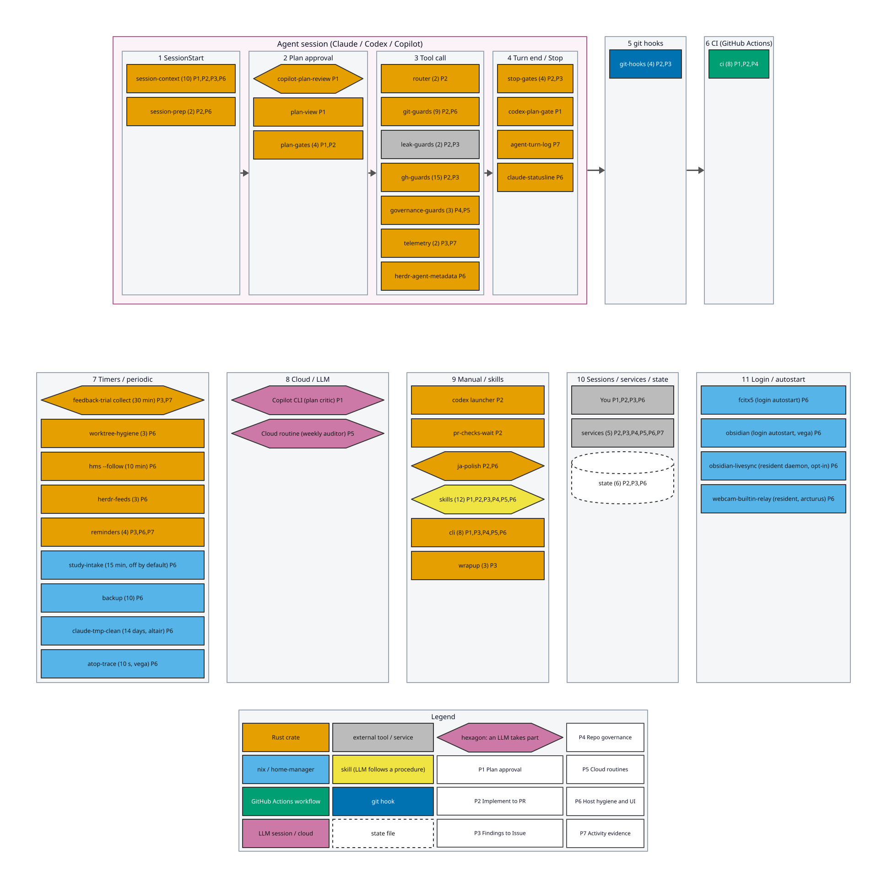

# docs/ index

What runs automatically, when, and on which stack: see the [pipeline map](pipeline-map.md).

## この索引について

文書の一覧は、各文書の H1(`# 題名`)から [`docs-index`](agents/docs-index.md) が生成する。1 行は、文書へのリンクと H1 だけで、
手で書いた要約は持たない(要約は文書の側で腐るので、見出しを正本にする)。文書を足す、題名を変える、置き場を移したら、
`cargo run -p docs-index -- render` で書き直す。書き直し忘れは、`cargo test --workspace`(CI の `Rust workspace`)が
`crates/docs-index/tests/tree.rs` で落とす。生成の外の文章は、手で書いたまま残る。

## Architecture Decision Records

決定の記録は [`adr/`](adr/) に置く。ADR の番号は、それを出す PR の番号に合わせる(起草中は仮番号 `0000`、
[`adr-numbering.md`](agents/adr-numbering.md))。一覧は番号の昇順で、仮番号は最後に並ぶ。

<!-- BEGIN GENERATED: docs-index adr -->
- [ADR-0001](adr/0001-home-manager-as-source-of-truth.md) — home-manager is the source of truth; apt and per-project runtimes are escape hatches (後続: 改訂 ADR-0029, ADR-457, ADR-1228)
- [ADR-0002](adr/0002-runtimes-and-hybrid-translation.md) — runtime consolidation + hybrid config translation (後続: 改訂 ADR-0029)
- [ADR-0003](adr/0003-secrets-and-identity.md) — secrets & identity: YubiKey-rooted, runtime-decrypted SOPS
- [ADR-0004](adr/0004-repo-identity-and-relocation.md) — repo identity & relocation to public `tarotene/dotfiles`
- [ADR-0005](adr/0005-shell-extension-init-no-auth-gate.md) — shell-extension init gates on binary existence, never on auth
- [ADR-0006](adr/0006-gl-for-nix-gui-apps.md) — nix GUI アプリは自前の GL スタックを抱える (後続: 改訂 ADR-0029)
- [ADR-0007](adr/0007-naming-and-layout-conventions.md) — 命名・配置規約
- [ADR-0008](adr/0008-documentation-artifact-selection.md) — 記録の器の選択規約 (後続: 改訂 ADR-380)
- [ADR-0009](adr/0009-publish-guard-upstream-split.md) — 公開面ガードの上流分離と配布
- [ADR-0010](adr/0010-retire-sops-runtime-secrets.md) — SOPS ランタイム復号チャネルの退役 (後続: 改訂 ADR-0022)
- [ADR-0011](adr/0011-local-activity-log-capture.md) — ローカル活動ログの採取(atuin + Claude Code ターンログ)
- [ADR-0012](adr/0012-precedent-grounding-over-prompted-adversarial-review.md) — プロンプトでの「敵対的レビュー」要求を、先行例接地 + 監査に機構化する
- [ADR-0013](adr/0013-repo-charter-schema.md) — 全自作リポジトリに README charter スキーマを強制する (後続: 置換 ADR-0016, ADR-0017)
- [ADR-0014](adr/0014-repository-naming-classes.md) — リポジトリ命名クラス体系を定め、GitHub topics を正本にする (後続: 置換 ADR-0026; 改訂 ADR-833)
- [ADR-0015](adr/0015-unified-github-audit-and-triage-loop.md) — 診断を統合 CLI に再編し、決定論ノード+LLM ノードの判断ループにする (後続: 改訂 ADR-0021)
- [ADR-0016](adr/0016-repository-document-canon.md) — リポジトリ文書正典: README 正形・litmus 移設・ルート閉集合・人間/AI 文書分離 (後続: 置換 ADR-0017, ADR-0028; 改訂 ADR-0033, ADR-805)
- [ADR-0017](adr/0017-contributing-schema.md) — CONTRIBUTING.md の固定スキーマと「Issue litmus」語彙の廃止 (後続: 改訂 ADR-805)
- [ADR-0018](adr/0018-darwin-host-and-homebrew-layer.md) — darwin ホストと macOS システム層の Homebrew 薄層写像 (後続: 改訂 ADR-1228)
- [ADR-0019](adr/0019-star-codename-hosts-and-marker-resolution.md) — 恒星コードネームのホスト命名と論理ホスト名のマーカー解決
- [ADR-0020](adr/0020-generative-repo-governance-rules.md) — リポジトリ統制を生成側規則(閉じた文法+語彙)に反転する (後続: 改訂 ADR-0026)
- [ADR-0021](adr/0021-ruleset-review-layer-addin.md) — ruleset baseline のコア層/レビュー層 2 層化
- [ADR-0022](adr/0022-esa-mcp-host-local-gpg-secret.md) — esa MCP トークンをホストローカル GPG ファイル + 専用 launcher で供給する
- [ADR-0023](adr/0023-repo-lifecycle-governance.md) — リポジトリライフサイクル統制(visibility/license/triage/consolidation)を dotfiles に正本化する
- [ADR-0024](adr/0024-hook-cli-scripts-target-rust.md) — hook / CLI スクリプト群の実装技術を Rust とする (後続: 置換 ADR-0027)
- [ADR-0025](adr/0025-update-own-tools-local-registry.md) — 自作 pre-release CLI の導入をホストローカルレジストリで opt-in する (後続: 改訂 ADR-0029, ADR-457)
- [ADR-0026](adr/0026-naming-lifecycle-axis-and-codename-split.md) — 命名クラス体系にライフサイクル軸を直交させ、naming-codename を分割する (後続: 改訂 ADR-833)
- [ADR-0027](adr/0027-uncertainty-first-stacking.md) — セッション内 PR は依存予測をやめ常時単一チェーンに積む(uncertainty-first stacking)
- [ADR-0028](adr/0028-readme-banner-and-third-party-assets.md) — README banner と第三者素材(repo ライセンスと異なる素材)の同梱規則
- [ADR-0029](adr/0029-path-precedence-enforces-source-of-truth.md) — PATH の優先順位を ADR-0001 の執行機構として宣言下に置く
- [ADR-0030](adr/0030-gas-clasp-basis-placement.md) — GAS/clasp 基盤の配置(正本分散・ナレッジは dotfiles・秘密はホストローカル)
- [ADR-0031](adr/0031-pr-title-as-commit-message-contract.md) — PR タイトルを commit-message 契約として機械強制する
- [ADR-0032](adr/0032-global-agent-instructions-canon.md) — グローバル agent 指示ファイルの正本は共有 AGENTS.md、CLAUDE.md は router
- [ADR-0033](adr/0033-nav-doc-no-materialisation.md) — 導線文書は実体を複製しない(nav-doc no-materialisation)
- [ADR-0034](adr/0034-machine-state-wrapper-flake.md) — 私的な machine-state 実値は、外側の private wrapper flake に置く
- [ADR-0035](adr/0035-selection-grounding.md) — 技術・仕組みの選択を 3 軸の辞書式順序に接地させる(selection-grounding)
- [ADR-380](adr/380-adr-number-by-pr.md) — ADR 番号をローカル連番でなく導入 PR の番号にする
- [ADR-387](adr/387-wrapup-chores-adjudication-first.md) — wrapup-chores を裁定前倒し型に反転する(adjudication-first)
- [ADR-396](adr/396-decision-colocation.md) — 決定成果物とその執行点を同じ PR にコロケーションする
- [ADR-436](adr/436-single-releaser-github-app.md) — releaser GitHub App を 1 個に集約し、宣言を workflow ファイルの存在に還元する
- [ADR-457](adr/457-claude-native-install-source-of-truth.md) — Claude Code 本体は native installer を正本にする
- [ADR-468](adr/468-stack-aware-heavy-ci.md) — stacked PR の中間段では重い CI ジョブを skip する
- [ADR-471](adr/471-cafe-wifi-tailscale-mesh-and-host-firewall.md) — カフェ Wi-Fi 対策: Tailscale メッシュ + Mullvad 出口 + ホスト firewall
- [ADR-478](adr/478-agent-verdict-ledger.md) — 自作ツールの deny/ask をローカルの判定レッジャーに集約し、人間の GO 後に開発元へフィードバックする
- [ADR-503](adr/503-rulesets-declaration-in-repo.md) — required status check の正本を対象リポジトリ自身の宣言に一本化する
- [ADR-519](adr/519-routines-declaration-in-repo.md) — Claude Code routine の正本を対象リポジトリ自身の宣言に一本化する
- [ADR-528](adr/528-due-remind-timer.md) — a generic reader for another repository's local due-index, on an hourly Herdr-notified timer
- [ADR-543](adr/543-existing-means-and-deterministic-promotion.md) — 既存手段の前倒し接地と、決定論への昇格導線 (後続: 改訂 ADR-1276, ADR-1311, ADR-1382)
- [ADR-544](adr/544-auto-prune-by-content-evidence.md) — worktree/branch の無人削除を「内容保全の証拠」で判定する
- [ADR-568](adr/568-renovate-automerge-shared-preset.md) — Renovate の自動マージ方針を単一の共有 preset に一本化し、Dependabot の修正経路を閉じる
- [ADR-590](adr/590-github-app-as-code.md) — GitHub App の登録・install 先・secret 配布を 3 層すべて宣言 → 検出の対象にする
- [ADR-591](adr/591-ci-workflow-naming.md) — 全リポジトリの CI workflow 命名基準を統一する (後続: 改訂 ADR-1005)
- [ADR-598](adr/598-pr-pending-work-to-issues.md) — PR 本文の人待ちチェックボックスを廃し、人の確認を後続 Issue へ払い出す
- [ADR-625](adr/625-llm-facing-hook-message-format.md) — LLM 向け hook 出力を `<hook-directive>` 外枠 + 英語本文で書く(試験導入)
- [ADR-640](adr/640-stack-standard-api-docs.md) — 技術スタック標準の API ドキュメントのビルドを全リポジトリで必須にする
- [ADR-697](adr/697-retro-stop-gate.md) — 作業終了時のレトロスペクティブを Stop hook で強制する (後続: 改訂 ADR-1276)
- [ADR-705](adr/705-main-checkout-guard.md) — 本物の checkout(main worktree)を変更させない
- [ADR-751](adr/751-sunk-cost-exclusion-in-selection.md) — 技術選定の裁定から歴史的経緯と書き直しの作業量を除く
- [ADR-792](adr/792-free-plan-declaration.md) — 無料プランの非公開リポジトリは、トピック `plan-free-private` の宣言で、成り立たない前提検査だけを外す
- [ADR-795](adr/795-esa-index-session-start-hook.md) — 社内 wiki のミラーの所在を SessionStart hook で注入する(esa-index)
- [ADR-805](adr/805-lang-ja-declaration.md) — 日本語が正本のリポジトリは、トピック `lang-ja` の宣言で、README/CONTRIBUTING の CJK 検査だけを外す
- [ADR-829](adr/829-actionable-light-human-tasks.md) — 軽い人手タスクは、着手可能になった日のうちに予定化する (後続: 改訂 ADR-1000)
- [ADR-833](adr/833-archived-naming-not-applicable.md) — アーカイブ済みのリポジトリには、naming の宣言の欠落(`class-undeclared`)を要求しない
- [ADR-872](adr/872-pipeline-map.md) — 自動発火する機構の地図を単一正本にし、登録箇所のポインタで網羅性を検査する
- [ADR-961](adr/961-annotations-domain.md) — GitHub Actions の warning を横断で拾う annotations ドメインを github-audit に足す
- [ADR-998](adr/998-worklog-vault-daily-note.md) — 粒度の小さい作業ログを、Obsidian vault の当日ノートへ worklog で追記し、SessionStart で渡す (後続: 改訂 ADR-1256, ADR-1291)
- [ADR-1000](adr/1000-schedule-light-tasks-before-unblock.md) — 待ちのある軽い人手タスクも、連鎖ごと先に予定へ入れる
- [ADR-1005](adr/1005-ci-gate-job-criteria.md) — CI の gate job を ci.yml に入れる基準を決め、検出と部品で全リポジトリに揃える
- [ADR-1040](adr/1040-agent-tooling-names-and-responsibilities.md) — エージェント向けツールの命名・責務・共有配置
- [ADR-1068](adr/1068-hms-follow-main.md) — main の更新に沿って hms を自動で当てる。ただし hms が main から作った世代だけに追従する
- [ADR-1136](adr/1136-wrapup-inbox-to-vault.md) — wrap-up inbox の気づきを Issue でなく vault のノートに溜め、裁定したものだけを Issue にする
- [ADR-1228](adr/1228-system-layer-declarations.md) — システム層の宣言と適用を分ける
- [ADR-1237](adr/1237-cachyos-migration-hold.md) — CachyOS への移行(#249)を保留し、固まりの記録で再訪の条件を確かめる
- [ADR-1242](adr/1242-calendar-handshake-spec.md) — 個人と勤務先のカレンダーの握手を Quint の仕様に書き、TLC で検査する。語彙は版 2 に上げる (後続: 改訂 ADR-1293)
- [ADR-1256](adr/1256-worklog-mail-kind.md) — worklog に mail kind を足し、読んだメールの裁定結論を vault に残す (後続: 改訂 ADR-1259)
- [ADR-1259](adr/1259-mail-lifecycle.md) — 未裁定のメール項目を閉じた状態機械で表し、必ず終端に入ることを形式検査する (後続: 改訂 ADR-1293)
- [ADR-1276](adr/1276-codify-signals.md) — 振り返りで as-code 化の候補を閉じた語彙で記録し、採用・却下の実績で語彙を直す
- [ADR-1291](adr/1291-task-slot-worklog.md) — 作業の枠の状態を worklog の slot kind で追い、時間枠は行に持つ (後続: 置換 ADR-1295; 改訂 ADR-1293)
- [ADR-1293](adr/1293-state-transition-vocabulary.md) — skill を対象の状態遷移の担い手と定義し、語彙 JSON の共通の形とグラフ検査を置く (後続: 改訂 ADR-1297, ADR-1400)
- [ADR-1295](adr/1295-slot-completion-record.md) — 作業の枠の時間は予定データに残し、worklog の slot kind は済んだ・やめたの完了記録だけを持つ
- [ADR-1297](adr/1297-awaiting-item-abstraction.md) — 「裁定待ちの項目」の抽象の遷移表を定め、メール項目・気づき・設定のずれ・計画の要求項目を具体化として書く (後続: 改訂 ADR-1381)
- [ADR-1301](adr/1301-dev-flow-vocabulary.md) — 開発の流れの対象(計画・PR・Issue・WIP の PR)の語彙を起こし、skill を担い手・前提として載せる
- [ADR-1305](adr/1305-env-maintenance-vocabulary.md) — 環境の保守の対象の語彙を起こし、載らない skill を落とす検査を CI に配線する
- [ADR-1311](adr/1311-git-external-state-integrity.md) — Git の外に置いた状態の整合を、日次の timer で読む
- [ADR-1358](adr/1358-record-layers.md) — 記録の層(L0〜L4)を宣言し、Write 時の拒否と日次のずれ検出で守る
- [ADR-1371](adr/1371-calendar-handshake-remote-kind.md) — 握手の語彙に、勤務先の不在を入れない予定の種類 remote-trip を足す
- [ADR-1379](adr/1379-issue-creation-ball-guard.md) — `gh issue create` を、ボールのラベルと本文の先頭行を持たせないと作れなくする
- [ADR-1381](adr/1381-inbox-finding-lapse.md) — 作業中の気づきの `open` に 14 日の期限を置き、超えたものを非終端の `lapsed` にする
- [ADR-1382](adr/1382-ledger-heartbeat.md) — 本人の Issue 台帳の、端末の生存の記録と、クラウドの日次の通知が途絶えたことを知る逆向きの確認
- [ADR-1387](adr/1387-ja-polish.md) — 日本語の文書は、Gemini の書き直しを通した証拠を記録して出す
- [ADR-1400](adr/1400-skill-entry-layers.md) — skill を「手で打つ入口」と「エージェントが選ぶ知識」の 2 層に分け、入口だけに `my-` を付けて、それ以外を `/` の一覧から隠す
- [ADR-1472](adr/1472-stop-outcome.md) — Stop hook の結果を `StopOutcome` と `Reentry` の型で持ち、描画を `Reply::render` の 1 か所に集める
<!-- END GENERATED -->

## 運用・調査・設計(`docs/` 直下)

<!-- BEGIN GENERATED: docs-index root -->
- [`cloud-artifacts-and-runbooks.md`](cloud-artifacts-and-runbooks.md) — クラウド成果物の命名規則と、人手を要する手順書(runbook)の書式
- [`codex-plan.md`](codex-plan.md) — codex-plan — Plan と実行のモデルを切り替える
- [`cutover-runbook.md`](cutover-runbook.md) — Cutover runbook — 手続き型の dotfiles から home-manager への、ホストごとの切り替え手順
- [`dotfiles-identity.md`](dotfiles-identity.md) — dotfiles-identity — 機体の identity とログイン中の Claude アカウントの一致を確かめる
- [`falcon-sensor.md`](falcon-sensor.md) — Falcon Sensor は専用スクリプトで会社用 PC に導入する
- [`gdrive-upload.md`](gdrive-upload.md) — gdrive-upload — ローカルのファイルを Google Drive の専用フォルダへ上げる(rclone、`drive.file`)。既存のファイルを取る読み取り側も持つ(`drive.readonly`)
- [`git-sync.md`](git-sync.md) — Git 同期設定 — herdr の並行 worktree が生む同期事故への手当て
- [`github-app-snapshot.md`](github-app-snapshot.md) — github-app-snapshot — GitHub App の設定を JSON で保存する読み取り専用の CLI
- [`github-audit.md`](github-audit.md) — github-audit — 全リポジトリを横断する GitHub の読み取り専用の監査
- [`ime-chrome-diagnosis.md`](ime-chrome-diagnosis.md) — Ctrl+Space が黙って効かない問題 — 調査記録
- [`kiriban.md`](kiriban.md) — キリ番(Issue / PR 番号のキリ番を祝う)
- [`local-state-backup.md`](local-state-backup.md) — ローカル状態バックアップと復旧
- [`model-equivalence.md`](model-equivalence.md) — model-equivalence — (モデル × エフォート)の乗り換え先を、根拠付きで引く
- [`nixification.md`](nixification.md) — Nixification — 将来 Nix の DSL に訳す価値のある設定ファイル
- [`operations.md`](operations.md) — Operations — 適用(hms)・flake の更新・新しい道具の置き場
- [`personal-cloud-projects.md`](personal-cloud-projects.md) — 個人ツールの自前クラウドプロジェクト命名・設定ポリシー
- [`pipeline-map.md`](pipeline-map.md) — 自動発火する機構の地図
- [`repo-lifecycle.md`](repo-lifecycle.md) — リポジトリライフサイクル統制(visibility / license / triage / consolidation)
- [`rust-migration.md`](rust-migration.md) — bash → Rust 移植の記録(ADR-0024、#389)
- [`rust-workspace-measurements.md`](rust-workspace-measurements.md) — Rust workspace の実測(#391 の完了条件)
- [`setup-macos.md`](setup-macos.md) — macOS Setup Guide (altair) — darwin ホストのセットアップ手順
- [`setup.md`](setup.md) — Setup Guide — ホストのセットアップ手順(Pop!_OS)
- [`shell-successor-research.md`](shell-successor-research.md) — シェルスクリプトの後継技術調査 — investigation record
- [`stacked-pr-github-native.md`](stacked-pr-github-native.md) — GitHub ネイティブ Stacked PR 機能の実態(調査記録)
- [`update-own-tools.md`](update-own-tools.md) — update-own-tools — 自作 pre-release CLI の更新
- [`waydroid.md`](waydroid.md) — Waydroid(Android コンテナ)で Android 版 LINE を動かす — vega
- [`webcam-builtin-ipu7.md`](webcam-builtin-ipu7.md) — 内蔵カメラ(Intel IPU7 + ov08x40)を arcturus の Web カメラにする
- [`webcam-osmo-pocket-3.md`](webcam-osmo-pocket-3.md) — Osmo Pocket 3 を vega の常用 Web カメラ + マイクにする
- [`worktree-lifecycle.md`](worktree-lifecycle.md) — worktree のライフサイクル監査
<!-- END GENERATED -->

## Agent tooling

[`agents/`](agents/) は、`config/agents/` から `home/modules/agents.nix` が配備する hook とコマンドの設計と根拠。

<!-- BEGIN GENERATED: docs-index agents -->
- [`agents/adr-numbering.md`](agents/adr-numbering.md) — adr-numbering — ADR 番号をローカル連番でなく導入 PR の番号にする
- [`agents/agent-libraries.md`](agents/agent-libraries.md) — エージェント向け共通ライブラリ
- [`agents/agent-permissions.md`](agents/agent-permissions.md) — Claude と Codex はそれぞれの native 権限設定を使う
- [`agents/agent-settings-reconcile.md`](agents/agent-settings-reconcile.md) — agent-settings-reconcile — 宣言を settings 系ファイルへ反映する
- [`agents/agent-tooling-authoring.md`](agents/agent-tooling-authoring.md) — agent-tooling-authoring スキル
- [`agents/attribution-guard.md`](agents/attribution-guard.md) — attribution-guard — AI 生成テキストに attribution を強制する PreToolUse hook
- [`agents/browser-login-handoff.md`](agents/browser-login-handoff.md) — browser-login-handoff — ブラウザ未ログイン時のハンドオフ手順を型化した理由
- [`agents/calendar-handshake.md`](agents/calendar-handshake.md) — calendar-handshake — 個人と勤務先のカレンダーの握手に使う印の語彙
- [`agents/ci-consumers.md`](agents/ci-consumers.md) — ci-consumers — 編集するパスを入力にしている CI の検査を、編集の前に引く
- [`agents/ci-wait-guard.md`](agents/ci-wait-guard.md) — ci-wait-guard — CI の待ち方を実行前に止め、`pr-checks-wait` へ案内する
- [`agents/codex-network-exceptions.md`](agents/codex-network-exceptions.md) — Codex の調査用ネットワーク例外
- [`agents/codify-signals.md`](agents/codify-signals.md) — as-code 化の候補を振り返りで記録する(段・兆候・既存手段)
- [`agents/copilot-plan-review.md`](agents/copilot-plan-review.md) — プランレビューは critic を黙らせるのではなく、受入基準で閉じる
- [`agents/decision-colocation.md`](agents/decision-colocation.md) — decision-colocation — 決定成果物と執行点を同じ PR に強制する
- [`agents/diagramming.md`](agents/diagramming.md) — diagramming スキル
- [`agents/docs-index.md`](agents/docs-index.md) — docs-index — `docs/README.md` の索引を、文書の H1 から生成する
- [`agents/esa-mcp.md`](agents/esa-mcp.md) — esa-mcp — esa.io MCP サーバのトークン供給
- [`agents/esa-mirror-context.md`](agents/esa-mirror-context.md) — esa-mirror-context — 社内 wiki のミラーの所在と引用形式を注入する hook
- [`agents/external-send-guard.md`](agents/external-send-guard.md) — external-send-guard — 外部宛メール・Slack 送信を下書きへ誘導する PreToolUse hook
- [`agents/feedback-trial.md`](agents/feedback-trial.md) — Bounded Codex feedback trial — 保存した Codex の会話から、観測の候補を別の収集役が集める試行
- [`agents/free-plan-declaration.md`](agents/free-plan-declaration.md) — free-plan-declaration — 無料プランの非公開リポジトリを、宣言 1 つで前提検査から外す
- [`agents/gas-clasp-ops.md`](agents/gas-clasp-ops.md) — gas-clasp-ops — Google Apps Script を clasp で CLI 操作する
- [`agents/gate-failopen-advisory.md`](agents/gate-failopen-advisory.md) — gate-failopen-advisory — fail-open で素通りし続けている gate を、セッション開始時に知らせる
- [`agents/gh-edit-allow.md`](agents/gh-edit-allow.md) — gh-edit-allow — 自セッションが作成した PR/Issue の編集を検証付きで allow する
- [`agents/git-checkout-sync.md`](agents/git-checkout-sync.md) — 親チェックアウトの鮮度を保つ systemd user timer
- [`agents/git-stash-guard.md`](agents/git-stash-guard.md) — git-stash-guard — 素の `git stash` を弾く PreToolUse hook
- [`agents/git-worktree-allow.md`](agents/git-worktree-allow.md) — git-worktree-allow — `git -C <worktree>` を検証つきで許可する PreToolUse hook
- [`agents/github-audit-triage.md`](agents/github-audit-triage.md) — github-audit-triage: 監査駆動の一括裁定スキルの設計理由
- [`agents/global-agents-md.md`](agents/global-agents-md.md) — global-agents-md — グローバル agent 指示の正本を共有 AGENTS.md に一元化する
- [`agents/gpg-prewarm.md`](agents/gpg-prewarm.md) — gpg-prewarm — [S]/[E] パスフレーズ入力を安全な瞬間に前倒しする hook
- [`agents/gpg-subkey-rotation.md`](agents/gpg-subkey-rotation.md) — gpg-subkey-rotation — GPG サブ鍵ローテーションを抜け漏れなく終わらせる
- [`agents/handoff.md`](agents/handoff.md) — handoff — 中断ハンドオフを Human / AI 双方に起票する仕組みの設計記録
- [`agents/herdr-sidebar-metadata.md`](agents/herdr-sidebar-metadata.md) — herdr-sidebar-metadata — エージェント毎のモード/モデルを Herdr サイドバーに常時表示する
- [`agents/herdr-status-advisory.md`](agents/herdr-status-advisory.md) — herdr-status-advisory — herdr の client と server の版の食い違いを、作業ツリーを切る前に知らせる
- [`agents/herdr-tab-bar-local.md`](agents/herdr-tab-bar-local.md) — herdr-tab-bar-local — タブバー右側に、ホストごとの 1 行を出すスロット
- [`agents/hook-router.md`](agents/hook-router.md) — hook-router — ツール呼び出しの検査を、1 つの登録にまとめる
- [`agents/human-task-scheduling.md`](agents/human-task-scheduling.md) — human-task-scheduling — 電話等ハンドオフ作業をカレンダーに反映する判断知識
- [`agents/inbox-adjudication.md`](agents/inbox-adjudication.md) — inbox-adjudication — 溜まった受信箱を、返信の裁定から処理する判断知識
- [`agents/issue-create-guard.md`](agents/issue-create-guard.md) — issue-create-guard — `gh issue create` を、ボールのラベルと本文の先頭行を持たせて作らせる
- [`agents/issue-index.md`](agents/issue-index.md) — issue-index — 自分に関係する open Issue の索引だけを注入する hook
- [`agents/issue-ref-freshness.md`](agents/issue-ref-freshness.md) — issue-ref-freshness スキル
- [`agents/ja-polish.md`](agents/ja-polish.md) — ja-polish — 日本語の文書を Gemini に書き直させ、通した証拠を残す
- [`agents/lang-ja-declaration.md`](agents/lang-ja-declaration.md) — lang-ja-declaration — 日本語が正本のリポジトリを、宣言 1 つで CJK 検査から外す
- [`agents/living-description.md`](agents/living-description.md) — living-description スキル
- [`agents/mail-lifecycle.md`](agents/mail-lifecycle.md) — mail-lifecycle — 未裁定のメール項目が、状態をたどって必ず終わる
- [`agents/main-checkout-guard.md`](agents/main-checkout-guard.md) — main-checkout-guard — 本物の checkout を変更させない PreToolUse + Stop hook
- [`agents/model-pin-update.md`](agents/model-pin-update.md) — model-pin-update スキル
- [`agents/music-performance-planning.md`](agents/music-performance-planning.md) — music-performance-planning — 演奏本番の練習・合わせ・当日ロジ支援
- [`agents/my-cleanup.md`](agents/my-cleanup.md) — my-cleanup — 片付けの入口: wrap-up inbox の気づきと open Issue を、本人が裁定して stacked PR で一括消化するスキル
- [`agents/my-desk.md`](agents/my-desk.md) — my-desk — その日にさばく作業を、朝の机 1 か所に集める入口
- [`agents/new-tool-guard.md`](agents/new-tool-guard.md) — new-tool-guard — 新しい道具・単位の着手前に、既存手段で足りないかを問う
- [`agents/obsidian-livesync-cli.md`](agents/obsidian-livesync-cli.md) — obsidian-livesync-cli — vega の LiveSync を公式 CLI の daemon に置き換える運用
- [`agents/pkexec-guard.md`](agents/pkexec-guard.md) — pkexec-guard — agent セッションから root 権限コマンドを polkit 経由で許す
- [`agents/pkill-guard.md`](agents/pkill-guard.md) — pkill-guard — 検索語が自分のコマンド行に当たる `pkill -f` / `pgrep -f` を、実行前に止める
- [`agents/plan-fresh-gate.md`](agents/plan-fresh-gate.md) — plan-fresh-gate — ExitPlanMode 直前のコードベース鮮度ゲート
- [`agents/plan-view.md`](agents/plan-view.md) — plan-view — プランを HTML にして Chrome の専用窓へ飛ばす
- [`agents/pr-description.md`](agents/pr-description.md) — pr-description スキル
- [`agents/pr-followup-guard.md`](agents/pr-followup-guard.md) — pr-followup-guard — PR 本文に未チェック task list を残さず、人の確認は Issue へ払い出す
- [`agents/pr-gate.md`](agents/pr-gate.md) — PR completion barrier — Stop の 1 点だけで CI 待ち・push 忘れを弾く
- [`agents/pr-title-contract.md`](agents/pr-title-contract.md) — pr-title-contract — PR タイトルを commit-message 契約として機械強制する
- [`agents/precedent-grounding.md`](agents/precedent-grounding.md) — precedent-grounding — 「敵対的レビュー」の都度指示を、先行例接地 + 監査に置き換える
- [`agents/presentation-authoring.md`](agents/presentation-authoring.md) — presentation-authoring スキル
- [`agents/promotion-detect.md`](agents/promotion-detect.md) — promotion-detect — Q2 の昇格・降格候補を日次で検出する
- [`agents/public-publish-guard.md`](agents/public-publish-guard.md) — public-publish-guard — 上流リポジトリへの配線(dotfiles 固有部分)
- [`agents/record-layers.md`](agents/record-layers.md) — record-layers — 記録の層(L0〜L4)の宣言と、Write の拒否・日次のずれ検出
- [`agents/repo-charter.md`](agents/repo-charter.md) — repo-charter: README charter スキーマの設計理由
- [`agents/repo-create-guard.md`](agents/repo-create-guard.md) — repo-create-guard — `gh repo create` を作成時点で repo-charter 手順に載せる PreToolUse hook
- [`agents/repo-structure-check.md`](agents/repo-structure-check.md) — repo-structure-check — リポジトリ構造の不変条件を、`cargo test` で検査する
- [`agents/requirements-inventory.md`](agents/requirements-inventory.md) — requirements-inventory — 依頼スコープの脱落を計画段階で塞ぐ
- [`agents/retro.md`](agents/retro.md) — 作業終了時のレトロ(ADR-697)
- [`agents/routines-write-guard.md`](agents/routines-write-guard.md) — routines-write-guard — 宣言外の cron routine 作成/更新を deny する
- [`agents/rulesets-write-guard.md`](agents/rulesets-write-guard.md) — rulesets-write-guard — GitHub ruleset の直接書換を deny する
- [`agents/sandbox-compound-guard.md`](agents/sandbox-compound-guard.md) — sandbox-compound-guard — sandbox の外で動かす道具の連結を、実行前に止める
- [`agents/slot-availability.md`](agents/slot-availability.md) — slot-availability — 候補日程 × Google Calendar の3コマ当たり判定
- [`agents/slot-offer.md`](agents/slot-offer.md) — slot-offer — 日程の提示と仮押さえを、1 提案 1 ジャーナルで食い違わせない
- [`agents/stack-base-guard.md`](agents/stack-base-guard.md) — stack-base-guard — セッション内 PR を常時単一チェーンに積む PreToolUse hook
- [`agents/stacked-pr.md`](agents/stacked-pr.md) — stacked-pr スキル
- [`agents/state-vocabulary.md`](agents/state-vocabulary.md) — state-vocabulary — 対象の状態遷移の語彙 JSON の書き方と検査
- [`agents/task-slot.md`](agents/task-slot.md) — task-slot — 作業の枠の「済んだ・やめた」を、作業ログに完了記録として残す
- [`agents/technology-selection.md`](agents/technology-selection.md) — technology-selection — 「クリーンかつ先進的」を検証可能な 3 軸に変換する
- [`agents/test-grounding.md`](agents/test-grounding.md) — test-grounding スキル
- [`agents/test-output-guard.md`](agents/test-output-guard.md) — test-output-guard — テストの出力を `head` / `tail` で切る形を、実行前に止める
- [`agents/tooling-conventions.md`](agents/tooling-conventions.md) — エージェント向けツールの命名と配置
- [`agents/tooling-migration.md`](agents/tooling-migration.md) — エージェント向けツールの移行
- [`agents/tracking-issue.md`](agents/tracking-issue.md) — tracking-issue スキル
- [`agents/venue-search.md`](agents/venue-search.md) — venue-search — 会場探しの判断知識と URL 生成
- [`agents/verdict-escalate.md`](agents/verdict-escalate.md) — verdict-escalate — 判定レッジャーの deny/ask を集約し、人間の GO 後に開発元へフィードバックする
- [`agents/worklog.md`](agents/worklog.md) — worklog — 粒度の小さい作業ログを、vault の当日ノートに 1 行ずつ書く
- [`agents/worktree-base-sync.md`](agents/worktree-base-sync.md) — pristine worktree の自動 fast-forward — herdr Workspace Fork の鮮度問題
- [`agents/worktree-lease.md`](agents/worktree-lease.md) — worktree-lease — 1 つの linked worktree を、同時に 2 つのセッションが git で動かさない
- [`agents/wrapup-inbox.md`](agents/wrapup-inbox.md) — wrap-up inbox — スコープ外の気づきを、vault のノートに溜めて、あとでまとめて裁定する
- [`agents/writing-style.md`](agents/writing-style.md) — writing-style — 執筆規約への薄いポインタ
<!-- END GENERATED -->

## Claude Code 固有

[`claude/`](claude/) は、Claude Code に固有の設計と根拠。

<!-- BEGIN GENERATED: docs-index claude -->
- [`claude/claude-mcp-servers.md`](claude/claude-mcp-servers.md) — claude-mcp-servers — `~/.claude.json` の `.mcpServers` を宣言的に管理する「口」
- [`claude/claude-permissions.md`](claude/claude-permissions.md) — claude-permissions — `permissions.allow` を宣言的に配る
- [`claude/claude-routines.md`](claude/claude-routines.md) — claude-routines — Claude Code routine を as-code で扱う仕組みの設計記録
- [`claude/claude-usage.md`](claude/claude-usage.md) — claude-usage — Herdr のタブバーに Claude の Rate Limit / Fable 使用量を常時表示する
- [`claude/codex-hook-parity.md`](claude/codex-hook-parity.md) — Claude と Codex で同じ Hook の検査を使う
- [`claude/codex-plan-gate.md`](claude/codex-plan-gate.md) — codex-plan-gate — Codex CLI の Plan mode に ExitPlanMode 相当の機械検査を課す Stop hook
- [`claude/global-claude-md.md`](claude/global-claude-md.md) — global-claude-md — 調査規律を全セッションに常時注入する
- [`claude/opusplan-model-aliases.md`](claude/opusplan-model-aliases.md) — opusplan-model-aliases — Plan/実行のモデルをペアで切り替える
<!-- END GENERATED -->

## エージェント向けツールの共通規約

- [命名と配置](agents/tooling-conventions.md)
- [ライブラリの責務](agents/agent-libraries.md)
- [改名・互換入口と削除条件](agents/tooling-migration.md)
