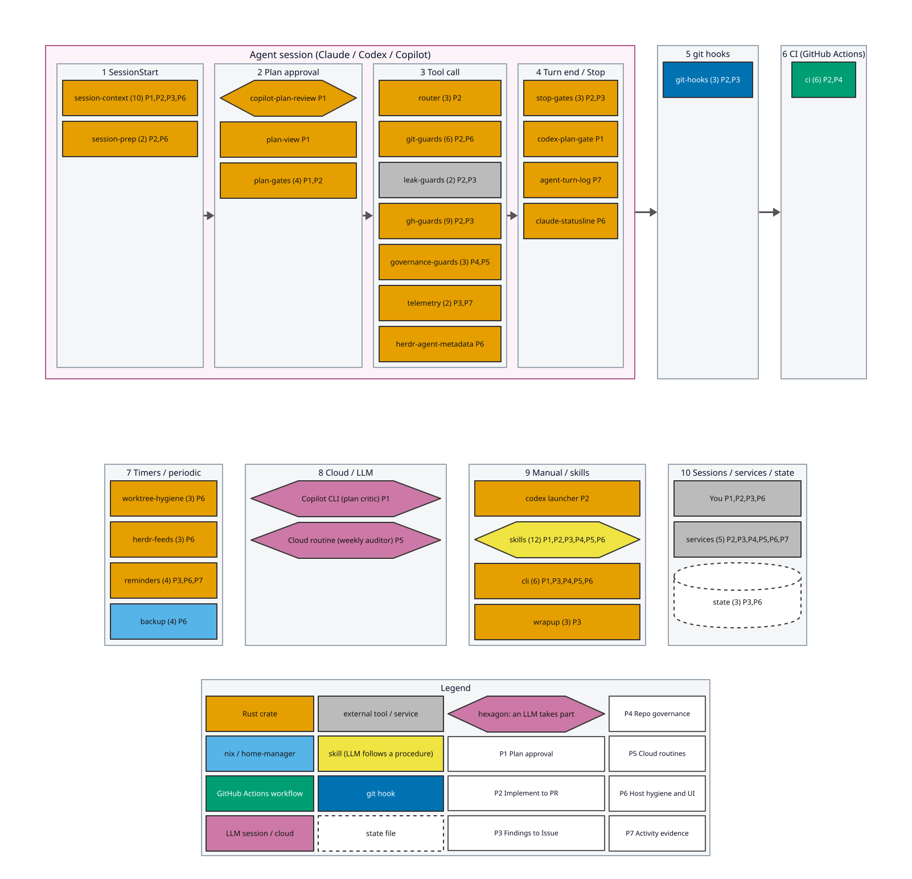
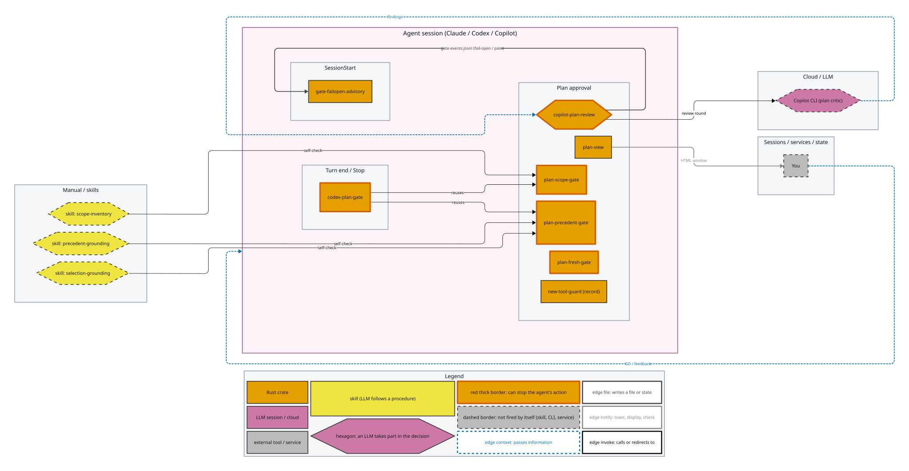
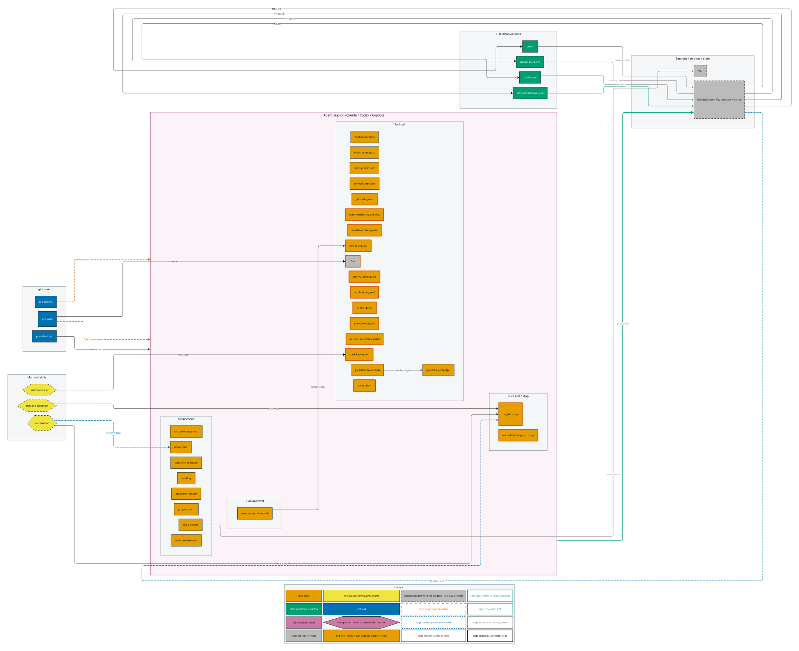
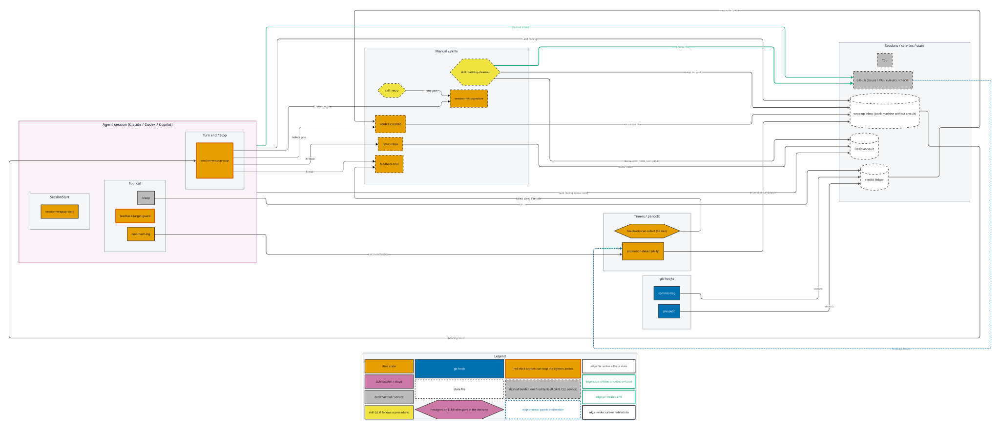
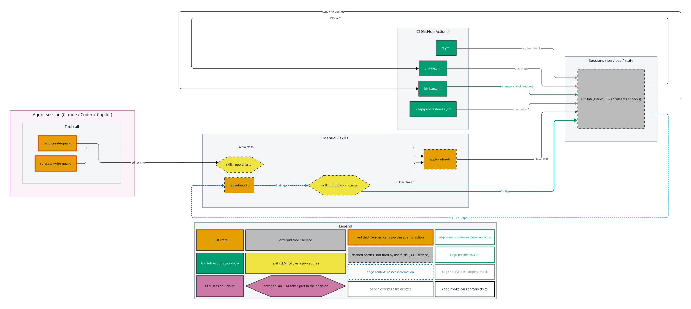
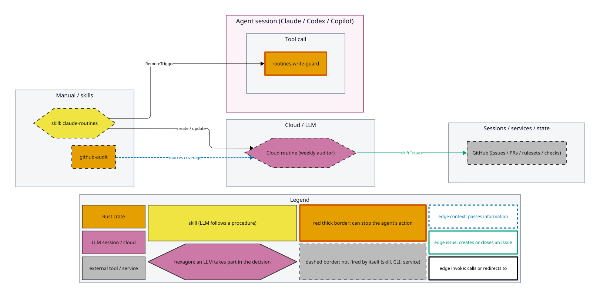
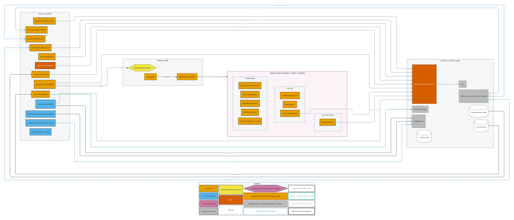
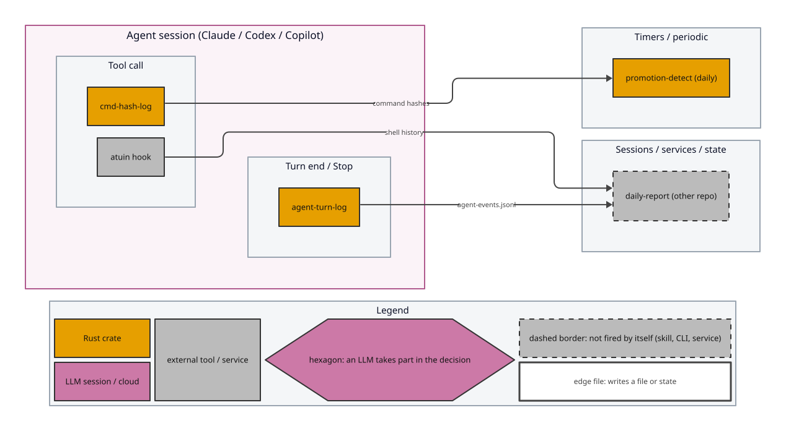

# 自動発火する機構の地図

人が名前を打たなくても走る機構(hook・timer・workflow・git hook・herdr の周期コマンド)が、いつ動き、何を次に渡し、何の上で動いているかを 1 枚にまとめた地図。
図は [`pipeline-map.toml`](../pipeline-map.toml) だけから作る。手で描かない。決定の根拠は [ADR-872](adr/872-pipeline-map.md)。

## 図の読み方

- **レーンの番号** は発火のきっかけで、小さい順が一連の流れ。1 から 4 は、エージェントのセッションの中で hook として発火する(ピンクの枠の中)。続く 5 と 6 は git の hook と CI。2 段目の 7 から 10 は、セッションと無関係に動くもの(周期の timer、cloud の LLM、手動の CLI と skill、外部のサービスと状態ファイル)。
- **色** は実装のスタック: Rust の crate、nix / home-manager、GitHub Actions の workflow、git hook、herdr、LLM のセッションや cloud、外部のツール、skill(LLM が手順書を読んで動く)、状態ファイル。
- **六角形** は LLM が判断に関わる機構。
- **`P` の番号** は属するパイプライン。凡例の対応表のとおりで、同じ番号の詳細図が下にある。
- **太い矢印** は一連の流れ(セッション、git hook、CI の順)。機構同士の配線は、概観には描かず詳細図が受け持つ。
- **詳細図の赤い太枠** は、そのセッション内の機構がエージェントの行為を止められる(deny)ことを示す。ハブ(エージェントのセッション)への配線は、全部描くと読めないので、ピンクのコンテナの入れ子と枠の色で表した。
- **点線の枠** は、それ自身では発火しないもの(skill、手動の CLI、外部のサービス)。

エッジの種類は 7 つ: `deny`(行為を止める)、`context`(情報を渡す)、`file`(ファイルや状態に書く)、`issue`(Issue を作る・閉じる)、`pr`(PR を作る)、`notify`(toast・表示・check)、`invoke`(呼ぶ・導く)。

## 7 本のパイプライン

### P1 Plan 承認

エージェントが計画を出して `ExitPlanMode` を呼ぶと、5 つの機構が並列に走る。
Copilot CLI が批評者として計画を読み(LLM)、gate が指摘の重さで通すか止めるかを決める。
`plan-view` は計画を HTML にして窓に出す(表示だけで承認には干渉しない)。
`plan-scope-gate` は依頼と参照 Issue の項目が要求インベントリに載っているかを、`plan-precedent-gate` は先行例の節の書式を、`plan-fresh-gate` は base が進んで計画が参照するファイルが変わっていないかを見る。
どれかが止めたら、エージェントは計画を直して `ExitPlanMode` をやり直す。
skill の scope-inventory・precedent-grounding・selection-grounding は、提出前に同じ gate を自分で呼んで確かめる手順を持つ。
Codex の Plan mode には `ExitPlanMode` が無いので、`codex-plan-gate` が Stop で同じ gate を再利用する。
批評のラウンドの上限と終わらせ方は [`copilot-plan-review.md`](claude/copilot-plan-review.md)。

### P2 実装から PR

セッションの開始時に、issue-index・esa-index・wrapup-session-start が文脈を注入し、worktree-fresh-base が作業ツリーを base へ fast-forward し、sign-prewarm が署名の pinentry を前倒しする。
ツール呼び出しのたびに、Bash や MCP への PreToolUse hook が並ぶ: 本物の checkout を変更させない、`git stash` を止める、`gh` の投稿に生成元の footer・Conventional Commits のタイトル・未チェックの task list の禁止・決定成果物の執行点を求める、stacked PR の base を親にそろえる、新しい道具に既存手段の検討を求める、非公開の名前の流出を止める(bleep)。
`git commit` と `git push` では git hook が走る(main への直接の commit を止める、push 前に bleep が走査する)。
`gh pr create` で PR ができると、GitHub が CI の workflow を起動し、必須の check の結果が `pr-gate` に戻る。
Stop で `pr-gate` が、push・PR・Issue のリンク・見た目の証跡・stack・CI がそろうまで止める。
マージされると `close-linked-issues` が Issue を閉じる。

### P3 気づきから Issue

作業のスコープ外で見つけた気づきは、エージェントが wrap-up inbox に追記する。
Stop で `wrapup-stop-gate` が inbox に未起票の行があれば止め、エージェントが `gh issue create` で Issue にする。
bleep と pre-push の走査は verdict ledger に判定を書き、同じ指紋の deny / ask が 3 回たまると、Stop の gate が呼ぶ `verdict-escalate` が inbox に行を足す([`verdict-escalate.md`](claude/verdict-escalate.md))。
`promotion-detect`(日次)は、実行したコマンドのハッシュと feedback の Issue を読み、決定論へ昇格させる候補を inbox に足す。
retro の skill は振り返りの行を足し、wrapup-chores の skill は溜まった inbox を 1 回の GO で stacked PR にまとめる。

### P4 repo governance

`github-audit` が全リポジトリを読み取り専用で監査し、`github-audit-triage`(skill、LLM)が drift を起草して PR にする。
ruleset の書き込みは `apply-rulesets` だけが正規の経路で、`rulesets-write-guard` は素の `gh api` の書き込みを止めてそこへ導く。
`repo-create-guard` は `gh repo create` を止めて repo-charter の手順へ導く。
CI の pr-title と必須の check が、各リポジトリで同じ判定エンジンを呼ぶ。
`bleep-pin-freshness` は、bleep の pin が古くなると annotation で知らせる。

### P5 cloud routine

routine は各リポジトリの宣言を正本とし、claude-routines の skill が `RemoteTrigger` で作る・更新する。
`routines-write-guard` は、宣言どおりの形でない cron の作成を止める。
cloud 上の週次の auditor(LLM)が drift を Issue にし、`github-audit` の routines ドメインが、auditor の対象の網羅を検査する。

### P6 ホストの衛生と UI

timer が定期に走り、結果を herdr の toast やサイドバー、または Issue に出す。
worktree の検出(1 分)は toast、親 checkout の fast-forward(10 分)は黙って、自動 prune(1 時間)は証跡のある worktree とブランチを消す。
due-remind(時間毎)は別リポジトリの期限の索引を読み、1 日 1 回 toast を出す。
gpg-subkey の期限(日次)は toast と、ローテーションの skill への導線。
detect-drift(週次)は宣言とのずれを非公開の Issue 置き場に出す。
Obsidian のバックアップ(日次、週次、月次)は B2 に書き、失敗を toast で知らせる。
herdr のサイドバーには、hook の metadata、statusline、claude-usage、issue 件数、ホスト固有の欄が流れる。
`hms` は適用のたびに `settings-reconcile` を呼び、hook の宣言を各ツールの設定ファイルへ反映する。

### P7 活動の証跡

`agent-turn-log` がプロンプトと Stop の事実を、atuin が shell の履歴を、別リポジトリの daily-report へ渡す。
`cmd-hash-log` は実行したコマンドの正規化ハッシュだけを記録し、`promotion-detect` が逐語の反復を見つける入力になる。

## 機構を足す・消すとき

1. [`pipeline-map.toml`](../pipeline-map.toml) にノードを足す(自動発火するなら `auto = true`)。lane・group・stack・pipelines・entity を書き、必要なら edge も足す。
2. 登録箇所にポインタを書く。Claude Code の hook 宣言は nix 属性 `node = "<id>";`、それ以外は登録の直前のコメント `pipeline-node: <id>`(Codex / Copilot の登録呼び出し、timer / launchd agent、workflow、git hook、herdr の command 行、statusline の定義)。
3. `cargo test -p pipeline-map` で、ポインタの漏れ・未定義の id・登録の無い自動ノードを確かめる。nix の評価時にも hook 宣言は検査される。
4. 図を作り直す: `nix develop` の中で `cargo run -p pipeline-map -- render`。`docs/assets/pipeline-map/` の差分をコミットする。CI が同じ手順で再生成し、差分があれば落とす。
5. 図を目視する(矢印の接続、はみ出し、重なり)。

消すときも同じで、manifest のノードを消す。登録箇所が無くなった `auto = true` のノードは `cargo test` が落とす。

## 限界

- 網羅が保証されるのは、自動発火する登録箇所の 8 クラスだけ(ADR-872 D4 の 7 クラスと、Amendment のルータの表)。手動の CLI と skill は、手渡し先として描くが、足し忘れは検出されない。
- 図のラベルは ASCII だけ。D2 が埋め込むフォントに CJK が無く、閲覧側のフォールバックで幅が変わるため。日本語の説明はこの文書の散文に書く。
- 配線の向きと件数は manifest に手書きする。機構の中身(何を次に渡すか)は、manifest から実体を読んで導いてはいない。登録箇所のポインタが保証するのは、機構の存在と、地図に載っていることまで。
